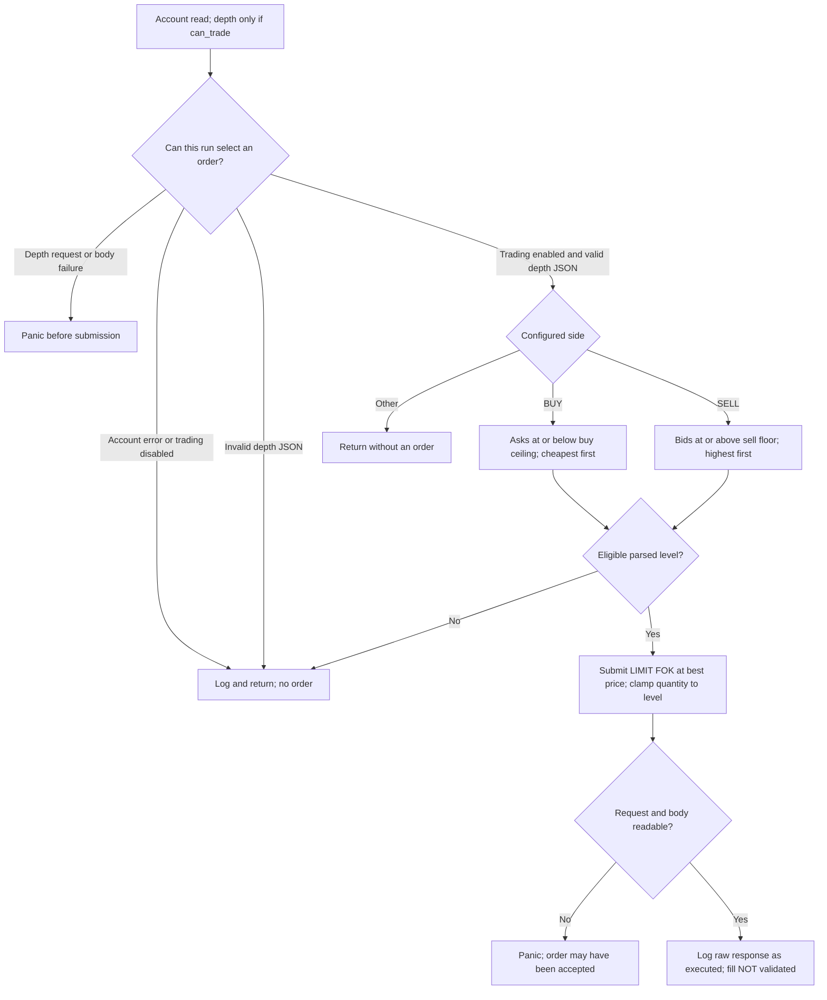

# Architecture

The runtime is a prototype, with no cross-venue coordinator. Domain docs describe intended boundaries; the tables below describe implemented behavior.

## Components and runtime configuration

| Component | Current behavior | Limitations |
| --- | --- | --- |
| `src/main.rs` | Tokio runtime, INFO-level `tracing`; awaits Binance once | No CLI, execution opt-in, or dry-run mode; Jupiter call is commented out |
| `src/binance.rs` | Synchronous connector requests inside an async runner; account → depth → optional order | Can block a Tokio worker; no market metadata, free-balance, filter, freshness, or risk validation |
| `src/binance/account_info.rs` | Signed account request; returns `AccountInfo` or contextual request/body/JSON error | Logs account type, `can_trade`, and balances using a literal string comparison with `"0.00000000"`; no numeric balance validation |
| `src/binance/model/order_book.rs` | Stores update ID and string pairs; threshold helpers parse `Decimal` and silently drop malformed levels | Unused best-level accessors substitute zero on parse failure; no receipt timestamp or snapshot validation |
| `src/binance/order_management.rs` | Unused query/cancel helpers; endpoint table below | Shared response model and panicking I/O |
| `src/jupiter.rs` | Quote prototype; workflow table below | Disabled in main; returns `()`, prints results, no normalized output or transactions |
| Other models | Binance `AvgPrice` and Jupiter `Order` model scaffolding | No average-price request or swap execution path uses them |
| Arbitrage coordinator | Not implemented | No cross-venue normalization, inventory management, risk policy, or two-leg recovery |

| Hard-coded setting | Value in source |
| --- | --- |
| Binance endpoint / credentials | `https://testnet.binance.vision` / literal `{api_key}` and `{secret_key}` placeholders |
| Market / depth | `BTCUSDT` / 100 levels |
| Side / desired quantity | `BUY` / `0.001` BTC |
| Buy ceiling / sell floor | `110000` / `45000` USDT per BTC |
| Jupiter endpoint | `https://lite-api.jup.ag/swap/v1/quote` |
| Jupiter mints | SOL `So11111111111111111111111111111111111111112`; USDC `EPjFWdd5AufqSSqeM2qN1xzybapC8G4wEGGkZwyTDt1v` |
| Jupiter amount | `1000000000` SOL base units (1 SOL); no configurable quote parameters |

These are source-code facts, not claims about current upstream API availability. Environment-based credential/configuration loading is not implemented; `.gitignore` excludes `/api_keys` but the runtime does not read it.

## Binance execution branches

The chart groups the pre-order checks for readability; the table preserves their order and exact failure behavior.

| Decision / operation | Exact behavior |
| --- | --- |
| Account gate | Request/body/JSON error logs a contextual error and returns. `can_trade == false` logs and returns before depth. |
| Depth read | Request/body failure panics before any order. Invalid `OrderBook` JSON logs the parse error and raw response, then returns. |
| BUY selection | Parse asks, discard malformed numeric levels, retain price `<= 110000`, sort ascending, select first level. |
| SELL selection | Parse bids, discard malformed numeric levels, retain price `>= 45000`, sort descending, select first level. This branch requires changing the hard-coded side. |
| No selection | No eligible level logs and returns; unsupported side silently skips both branches after the depth read. |
| Submission | Quantity is `min(0.001, selected level quantity)`; submit one signed LIMIT FOK at that level's price. |
| Submission result | Request/body failure panics and may leave an accepted order. A readable body is logged without parsing status, quantity, or expiry reason. |

A price limit does not target an individual resting order. The runner uses one eligible level rather than aggregating depth. Numeric parse failures are discarded before threshold selection; HTTP/body success is not confirmation of a fill. There is no explicit caller-controlled reconciliation ID, retry loop, or balance reconciliation.

The [Binance sequence](binance_spot_flow.puml) shows account/helper ownership and the external side-effect boundary. Render with `plantuml docs/architecture/binance_spot_flow.puml` if installed. The decision chart above owns branch detail; the sequence owns request/response interactions.

### Order-management helpers (not called by main)

| Helper | Request intent / return | Error and model behavior |
| --- | --- | --- |
| `get_open_orders` | Query open orders / `Vec<OpenOrder>` | `working` maps to `working`, not `isWorking`; model requires `time` and `updateTime` |
| `cancel_order` | Cancel by symbol + order ID / `OpenOrder` | Reuses open-order fields; does not model cancellation `transactTime` |
| `cancel_all_orders` | Cancel open orders for symbol / `Vec<OpenOrder>` | Assumes homogeneous open-order shape; no order-list report variant |

All three panic on connector/body errors and return deserialization errors as `JsonError`. They log success only after deserialization. Endpoint-model corrections remain [unfinished work](../../INBOX.md).

## Jupiter quote workflow

A table is sufficient for this predominantly linear workflow; its failure branches do not justify a separate sequence diagram.

| Stage | Implemented action | Failure / boundary |
| --- | --- | --- |
| Entry | `run()` exists but is not called by main; prints host | No runtime option enables it |
| URL | Build SOL → USDC query with the mint/amount constants above | URL parsing uses `unwrap()` |
| Request | `reqwest::get(url).await` | Transport failure prints a diagnostic and returns; no reusable configured client, explicit timeout, or retry policy |
| Response | Print status and headers, then read body | No status rejection via `error_for_status`; body-read failure panics |
| Decode | Deserialize `QuoteResponse` | Malformed JSON/schema prints raw body and parse error; amount/fee/impact fields remain strings; no domain validation |
| Output | Pretty-serialize and print quote | Serialization uses `unwrap()`; function returns `()`; no data passes to Binance |
| Execution | None | No build/sign/simulate/submit/confirm flow, wallet loading, or RPC client |

## Verification and operating boundary

| Topic | Current support / retained constraint |
| --- | --- |
| Deterministic checks | `scripts/verify.sh`: formatting, strict Clippy, tests, release build. Current automated coverage is one Jupiter quote fixture test; it is not execution coverage. |
| Build | `cargo fetch`, `cargo build`, and `cargo build --release` do not run the workflow. Binary/package name: `CryptoArbitrage`. |
| Secrets | No secret loader; use external configuration before extending execution. Never log complete sensitive payloads; use least-privilege keys with withdrawals disabled where possible. |
| Experiments | Keep exploratory code separate from the trading binary and production credentials; no real trades. |
| Releases | No publication/deployment automation. Package version is in `Cargo.toml`; previous conventions were semantic versions and `<type>(<optional-scope>): 
` commit/PR titles. |

Do not label this prototype production-ready. Missing controls and unresolved choices are tracked in [INBOX](../../INBOX.md).

## Domain boundaries

| Boundary | Responsibility |
| --- | --- |
| [Arbitrage](../domain/arbitrage-domain.md) | Normalized comparison, inventory, risk, and coordination; evaluation cannot submit orders |
| [Binance](../domain/binance-domain.md) | Spot transport, account state, depth, filters, and orders |
| [Jupiter](../domain/jupiter-domain.md) | Mint/base-unit semantics, routed quotes, and future Solana transactions |
